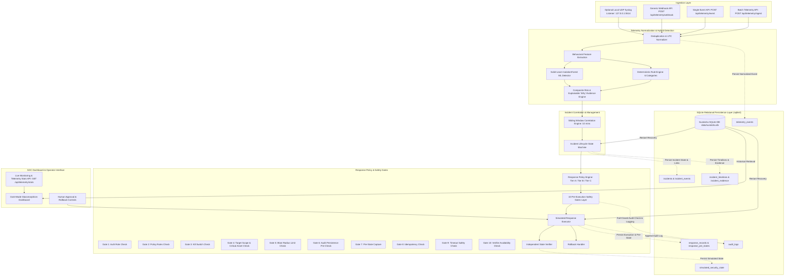

# System Architecture (ARCHITECTURE.md)

## System: Suraksha AI (Phase 4 Architecture)

Suraksha AI provides an end-to-end autonomous cyber threat detection, incident correlation, risk explanation, safe response simulation, and SQLite-backed persistence pipeline.



---

## Relational Schema Design

The SQLite database (`DatabaseManager`) enforces the following relational architecture:

| Table Name | Primary Key | Key Foreign Keys / Indexes | Purpose |
|---|---|---|---|
| `telemetry_events` | `event_id` (TEXT) | `idx_te_timestamp`, `idx_te_source_ip`, `idx_te_user` | Persists raw incoming normalized telemetry events and payload JSON. |
| `incidents` | `incident_id` (TEXT) | `idx_inc_status`, `idx_inc_risk` | Stores correlated incident header, severity, composite risk, and status. |
| `incident_events` | `(incident_id, event_id)` | FK `incident_id` $\rightarrow$ `incidents` | Maps many-to-many relationships between incidents and constituent events. |
| `incident_timelines` | `id` (INTEGER AUTO) | FK `incident_id` $\rightarrow$ `incidents` | Chronological event timeline entries detailing multi-stage attacks. |
| `incident_evidence` | `id` (INTEGER AUTO) | FK `incident_id` $\rightarrow$ `incidents` | Explainable "Why" evidence points explaining the risk calculation. |
| `incident_threat_categories` | `(incident_id, category)`| FK `incident_id` $\rightarrow$ `incidents` | Threat categories detected across multi-stage correlated incidents. |
| `response_records` | `action_id` (TEXT) | `idx_resp_incident`, `idx_resp_target` | Persists simulated actions (`BLOCK_IP`, `ISOLATE_ENDPOINT`, etc.) and status. |
| `response_pre_states` | `(action_id, key)` | FK `action_id` $\rightarrow$ `response_records` | Captured system pre-state values for independent rollback verification. |
| `simulated_security_state` | `(state_type, target)` | Unique composite key | Tracks active simulated enforcement (e.g. `BLOCKED_IP`, `ISOLATED_HOST`). |
| `audit_logs` | `log_id` (TEXT) | `idx_audit_timestamp`, `idx_audit_action` | Append-only audit entries recording actor, action, timestamp, and details. |

---

## Ingestion Pipelines & Endpoints

### 1. Single-Event Telemetry (`POST /api/telemetry/event`)
- Validates payload against Pydantic `TelemetryInput`.
- Normalizes timestamp to ISO-8601 UTC.
- Evaluates event against sliding deduplication cache.
- Runs rule-based and IsolationForest anomaly detection.
- Persists accepted telemetry to `telemetry_events` table.
- Feeds event into `IncidentManager` for multi-event correlation.

### 2. Generic Security Webhook (`POST /api/telemetry/webhook`)
- Ingests generic external security payloads from SIEMs or intrusion alert tools.
- Supports optional token header verification via `X-Suraksha-Token` matching `SURAKSHA_WEBHOOK_SECRET`.
- Maps generic attributes (e.g., `src_ip`, `user`, `dest_ip`, `bytes`) to standard telemetry fields.
- Reuses the standard normalization and detection pipeline without secondary code forks.

### 3. Optional Local UDP Syslog Listener (`backend/telemetry/syslog_listener.py`)
- Configured via `SURAKSHA_SYSLOG_ENABLED=true` (defaults to disabled).
- Binds strictly to loopback `127.0.0.1:5514` to prevent external network exposure.
- Parses RFC3164 and RFC5424 formatted messages and feeds them safely into the normalization pipeline.

---

## Response Policy & Safety Gate Architecture

### Tier Enforcement Semantics
- **Tier A (Low Risk / Alert-Only)**: Automatically executes `ALERT_ONLY` with zero network impact.
- **Tier B (Medium Risk / Low-Impact Remediation)**: Automatically executes bounded actions (`BLOCK_IP`, `SUSPEND_SESSION`) with immediate audit notification, provided all 10 gates pass.
- **Tier C (High Risk / Severe Action)**: High-impact actions (`ISOLATE_ENDPOINT`) or actions against critical assets require explicit human approval. Capped at `PENDING_APPROVAL`.
- **ML Anomaly Cap**: IsolationForest anomaly detections lacking deterministic rule corroboration are capped at Tier C (human approval required).

### 10 Pre-Execution Safety Gates
```text
Action Request
  ↓
[Gate 1: Authorization Role Check]       (Actor must possess ADMIN/ANALYST rights)
  ↓
[Gate 2: Response Policy Rules Check]    (Action must be allowed for the given category)
  ↓
[Gate 3: Emergency Kill Switch Check]    (Must be OFF; if ON, halts auto-execution)
  ↓
[Gate 4: Target Scope & Critical Asset]  (Valid target string format + protects whitelisted assets)
  ↓
[Gate 5: Blast Radius Limit Check]       (Max 5 concurrent active blocked IPs / isolated hosts)
  ↓
[Gate 6: Audit Persistence Pre-Check]    (Verifies SQLite database is write-accessible; fails closed)
  ↓
[Gate 7: Pre-State Capture]              (Records target pre-action state for rollback)
  ↓
[Gate 8: Idempotency Check]              (Rejects repeated redundant actions on same target)
  ↓
[Gate 9: Execution Timeout Safety]       (Execution simulation completes within bounded 5000ms)
  ↓
[Gate 10: Verifier Availability Check]   (Independent verifier must be online)
  ↓
Simulated Action Execution
```

---

## Restart Recovery & Reliability State Machine

When the FastAPI service restarts:
1. `DatabaseManager` connects to `data/suraksha.db`.
2. Existing schema tables and indexes are initialized if absent (`CREATE TABLE IF NOT EXISTS`).
3. `IncidentManager` loads all prior incidents, reconstructs timeline entries, evidence points, and constituent event IDs.
4. `ResponseExecutor` loads all executed and pending response records along with pre-state snapshots.
5. In-flight pending approvals remain pending (`ActionStatus.PENDING_APPROVAL`) and are never automatically fired.
6. The global kill switch initializes to a safe default (`SURAKSHA_KILL_SWITCH_DEFAULT`, default `false`).
