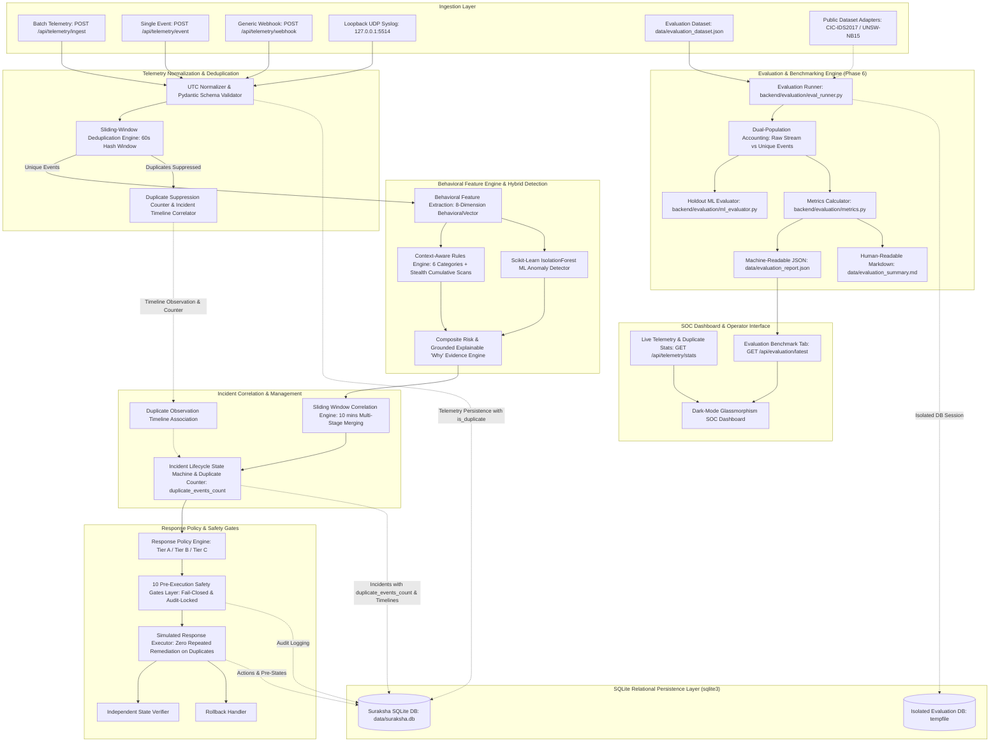

# System Architecture (ARCHITECTURE.md)

## System: Suraksha AI (Phase 6 Architecture)
### Precision Tuning, Duplicate-Aware Correlation & Evaluation Hardening

Suraksha AI provides an end-to-end autonomous cyber threat detection, incident correlation, explainable risk scoring, safe response simulation, SQLite persistence, and quantitative detection quality evaluation pipeline.

---

## Component Enhancements in Phase 6

### 1. Context-Aware Lateral Movement Detection
- **Module**: [`backend/detection/rules_engine.py`](file:///c:/Users/NAKSHATRA%20SV/OneDrive/Documents/Cyber-threat-detection/backend/detection/rules_engine.py)
- **Features**:
  - Distinguishes routine low-volume port checks ($< 5.0$ targets) by authorized ops/scanner users on non-critical assets from malicious activity.
  - Critical assets (`CRITICAL` / `HIGH` or identifying hostnames like database/auth gateways) are **never silently exempted**.
  - Cumulative reconnaissance tracker detects stealthy low-volume probes accumulated across sequential events.

### 2. Observable Duplicate Event Management & Idempotency
- **Modules**: [`backend/detection/normalizer.py`](file:///c:/Users/NAKSHATRA%20SV/OneDrive/Documents/Cyber-threat-detection/backend/detection/normalizer.py), [`backend/incidents/correlation.py`](file:///c:/Users/NAKSHATRA%20SV/OneDrive/Documents/Cyber-threat-detection/backend/incidents/correlation.py), [`backend/database.py`](file:///c:/Users/NAKSHATRA%20SV/OneDrive/Documents/Cyber-threat-detection/backend/database.py)
- **Features**:
  - Duplicates are suppressed from triggering detection engines or automated remediation.
  - When an active incident matches the duplicate's entity context, a `DUPLICATE_OBSERVATION` entry is safely appended to the incident timeline.
  - Incidents persist `duplicate_events_count` in SQLite, surviving system restarts.
  - Telemetry statistics API (`GET /api/telemetry/stats`) exposes `total_raw_events`, `total_unique_events`, and `total_duplicates_suppressed`.

### 3. Dual-Population Evaluation Engine
- **Modules**: [`backend/evaluation/eval_runner.py`](file:///c:/Users/NAKSHATRA%20SV/OneDrive/Documents/Cyber-threat-detection/backend/evaluation/eval_runner.py), [`backend/evaluation/metrics.py`](file:///c:/Users/NAKSHATRA%20SV/OneDrive/Documents/Cyber-threat-detection/backend/evaluation/metrics.py)
- **Features**:
  - Population 1 (Unique Normalized Events, $N_{\text{unique}} = 31$): Evaluates Precision (91.3%), Recall (100.0%), and F1 (95.5%) without false-negative penalty for suppressed duplicates.
  - Population 2 (Raw Telemetry Stream, $N_{\text{raw}} = 33$): Tracks raw ingestion, duplicate suppression rate (6.1%), and timeline attachment rate (100.0%).
  - Multi-stage attack scenario grouping achieves 100.0% accuracy across 15 distinct campaigns.

### 4. Decoupled Public Dataset Adapters
- **Module**: [`backend/evaluation/public_dataset_adapter.py`](file:///c:/Users/NAKSHATRA%20SV/OneDrive/Documents/Cyber-threat-detection/backend/evaluation/public_dataset_adapter.py)
- **Features**:
  - Maps external flow records (CIC-IDS2017, UNSW-NB15) into the `NormalizedEvent` schema.
  - Zero fabrication: marks evaluation status as `PENDING_LOCAL_DOWNLOAD` when raw external datasets are not placed in the repository.
