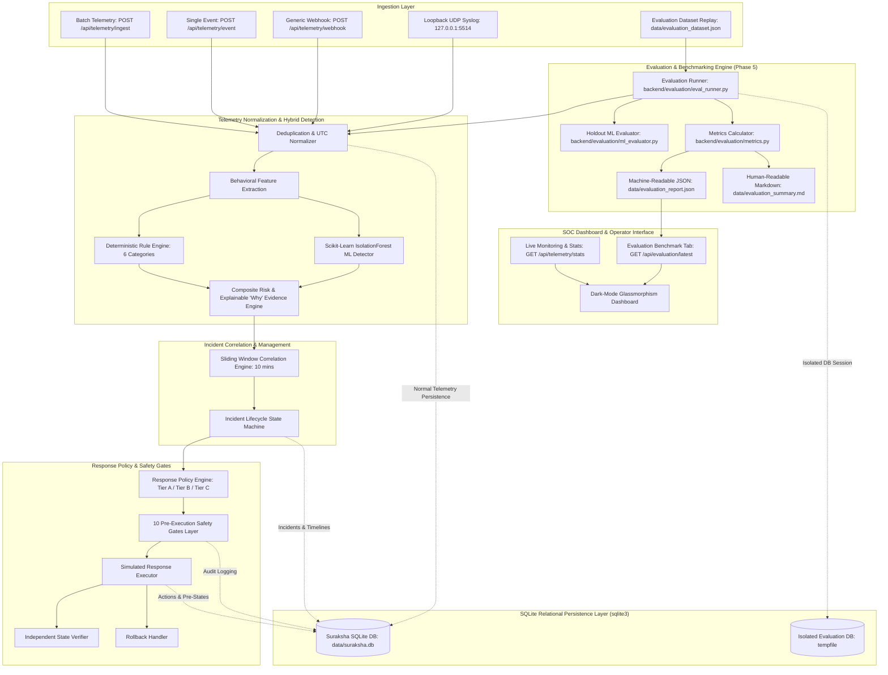

# System Architecture (ARCHITECTURE.md)

## System: Suraksha AI (Phase 5 Architecture)

Suraksha AI provides an end-to-end autonomous cyber threat detection, incident correlation, explainable risk scoring, safe response simulation, SQLite persistence, and quantitative detection quality evaluation pipeline.

---

## Evaluation Engine Architecture (Phase 5)

Implemented in [`backend/evaluation/`](file:///c:/Users/NAKSHATRA%20SV/OneDrive/Documents/Cyber-threat-detection/backend/evaluation/), the Evaluation Engine provides reproducible, isolated statistical benchmarking:

1. **Evaluation Runner ([`backend/evaluation/eval_runner.py`](file:///c:/Users/NAKSHATRA%20SV/OneDrive/Documents/Cyber-threat-detection/backend/evaluation/eval_runner.py))**:
   - Creates a dedicated temporary SQLite database (`tempfile.NamedTemporaryFile`) to guarantee zero contamination of `data/suraksha.db`.
   - Iterates through the 24 labeled evaluation events in [`data/evaluation_dataset.json`](file:///c:/Users/NAKSHATRA%20SV/OneDrive/Documents/Cyber-threat-detection/data/evaluation_dataset.json).
   - Collects predictions from:
     - Deterministic Rules alone
     - Scikit-Learn IsolationForest alone
     - Hybrid Pipeline (Suraksha AI)
2. **Metrics Calculator ([`backend/evaluation/metrics.py`](file:///c:/Users/NAKSHATRA%20SV/OneDrive/Documents/Cyber-threat-detection/backend/evaluation/metrics.py))**:
   - Computes binary confusion matrices (TP, FP, TN, FN).
   - Evaluates Precision, Recall, F1 Score, False Positive Rate (FPR), and Accuracy.
   - Enforces explicit zero-denominator handling policy.
   - Computes One-vs-Rest classification metrics across all 6 threat categories and benign traffic.
   - Evaluates multi-event attack sequence grouping accuracy, split scenarios, and cross-incident contamination.
3. **Leak-Free ML Evaluator ([`backend/evaluation/ml_evaluator.py`](file:///c:/Users/NAKSHATRA%20SV/OneDrive/Documents/Cyber-threat-detection/backend/evaluation/ml_evaluator.py))**:
   - Generates an independent holdout dataset of 200 behavioral vectors (150 normal, 50 anomalous) using random seed `101`, preventing data leakage with the training baseline (seed `42`).
   - Assesses IsolationForest decision function scores and validates the Tier C safety invariant (anomaly score alone never authorizes remediation).
