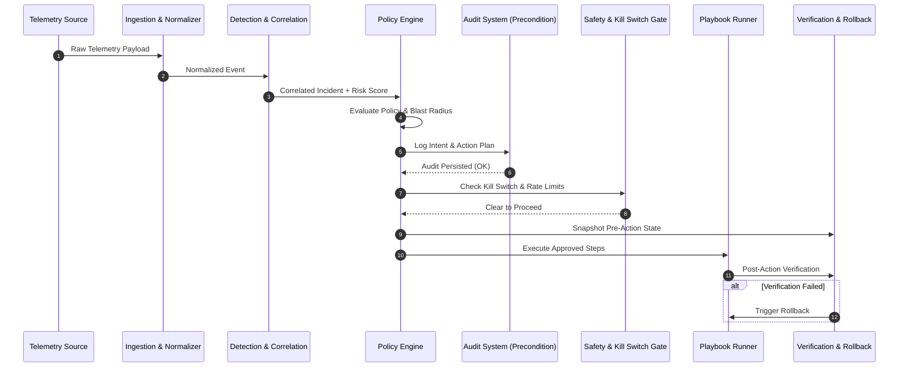

# System Architecture Specification

**Document Version:** 1.0.0  

---

## 1. High-Level Architecture Overview

The system follows a clean modular event-driven architecture designed around strict safety gates, immutable audit guarantees, and vendor isolation.

```
 +------------------+     +-------------------+     +---------------------+
 | Telemetry Sources|     |  Connector Layer  |     | Normalizer &        |
 | (SIEM, EDR, Net) | --> | (Vendor Adapters) | --> | Deduplicator        |
 +------------------+     +-------------------+     +---------------------+
                                                               |
                                                               v
 +------------------+     +-------------------+     +---------------------+
 |  Correlated      |     | Threat Detection  |     | Normalized Event    |
 |  Incident        | <-- | Engine (Rules+ML) | <-- | Queue               |
 +------------------+     +-------------------+     +---------------------+
          |
          v
 +------------------+     +-------------------+     +---------------------+
 | Scoring Engine   | --> | Policy Engine     | --> | Playbook Framework  |
 | (Risk & Conf)    |     | (Response Tiers)  |     | & Pre-Action Snap   |
 +------------------+     +-------------------+     +---------------------+
                                                               |
                                                               v
                                                    +---------------------+
                                                    | Audit System        |
                                                    | (Hard Precondition) |
                                                    +---------------------+
                                                               |
                                                               v
                                                    +---------------------+
                                                    | Safety & Kill Switch|
                                                    | Gate & Execution    |
                                                    +---------------------+
```

---

## 2. Core Architectural Components

### 2.1 Connector & Ingestion Subsystem
- **Purpose**: Ingest raw vendor telemetry, isolate vendor specifics, and emit schema-conformant `NormalizedEvent` records.
- **Components**: `BaseConnector`, `Ingestor`, `Normalizer`, `Deduplicator`.

### 2.2 Analytics & Scoring Subsystem
- **Purpose**: Process events, detect anomalies/signatures, correlate into incidents, and compute composite risk scores.
- **Components**: `DetectionEngine`, `CorrelationEngine`, `RiskScoringEngine`.

### 2.3 Policy & Response Subsystem
- **Purpose**: Map risk scores to response tiers, validate safety constraints, snapshot state, persist audit events, and execute playbooks.
- **Components**: `PolicyEngine`, `PlaybookRunner`, `AuditLogger`, `VerificationEngine`, `RollbackManager`.

### 2.4 Safety & Security Control Plane
- **Purpose**: Enforce RBAC access control, global emergency kill switch, rate limits, and blast radius boundaries.
- **Components**: `GlobalKillSwitch`, `RBACController`, `BlastRadiusLimiter`.

---

## 3. Data Flow & Safety Sequence Diagram


