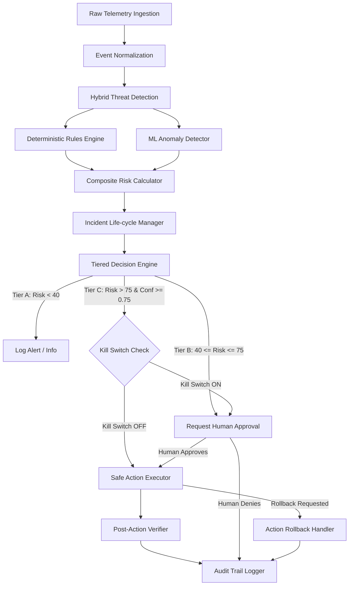

# System Architecture (ARCHITECTURE.md)

## Pipeline Overview

---

## Component Specifications

### 1. Ingestion & Normalizer (`backend/detection/normalizer.py`)
Standardizes raw syslog, JSON, and network logs into `NormalizedEvent`:
- `event_id`: Unique UUID4 string.
- `timestamp`: Standard UTC ISO-8601 string.
- `source_ip`: IPv4 / IPv6 string.
- `user_id`: Target user handle or system account.
- `event_type`: e.g. `LOGIN_FAILED`, `AUTH_SUCCESS`, `SUDO_EXEC`, `HTTP_REQUEST`, `BYTES_OUT`.
- `asset_id`: Targeted asset name or host.
- `asset_criticality`: High (1.5x multiplier), Medium (1.2x), Low (1.0x).
- `payload_metric`: Numeric metric (bytes transferred, attempt counts, beacon intervals).

### 2. Detection Engine (`backend/detection/`)
- **`rules_engine.py`**: Evaluates 6 categories (`SUSPICIOUS_LOGIN`, `BRUTE_FORCE`, `PRIVILEGE_ESCALATION`, `LATERAL_MOVEMENT`, `C2_ACTIVITY`, `UNUSUAL_DATA_TRANSFER`).
- **`ml_detector.py`**: Uses an IsolationForest model trained on multivariate numeric vectors (`[failed_logins, data_out_mb, port_entropy, time_of_day]`) to output an Anomaly Score $\in [0.0, 1.0]$.

### 3. Risk & Decision Engine (`backend/detection/risk_calculator.py`, `backend/response/decision_engine.py`)
$$ \text{Risk Score} = \min\left(100, (\text{RuleSeverity} \times 0.6 + \text{MLScore} \times 40) \times \text{AssetCriticality} \right) $$
$$ \text{Confidence Score} = \frac{\text{RuleConfidence} + \text{MLScore}}{2} $$

### Decision Tiering Matrix
- **Tier A (Info/Low)**: Risk $< 40$. Log alert only.
- **Tier B (Medium)**: $40 \le \text{Risk} \le 75$. Requires Human Approval via Dashboard before execution.
- **Tier C (High/Critical)**: Risk $> 75$ AND Confidence $\ge 0.75$. Auto-executes safe simulated response UNLESS Kill Switch is Active.

### 4. Safe Executor, Verifier & Rollback (`backend/response/executor.py`, `verifier.py`)
- `BLOCK_IP`: Simulates dynamic IP block. Verification checks active simulated firewall table. Reversible via `UNBLOCK_IP`.
- `SUSPEND_SESSION`: Invalidates target token state. Reversible via `REACTIVATE_SESSION`.
- `ISOLATE_ENDPOINT`: Sets endpoint network flag to Isolated. Reversible via `REJOIN_NETWORK`.

### 5. Audit & RBAC (`backend/audit/logger.py`, `backend/rbac.py`)
- Tamper-evident append-only JSON structure.
- Roles: `ADMIN`, `ANALYST`, `AUDITOR`.
