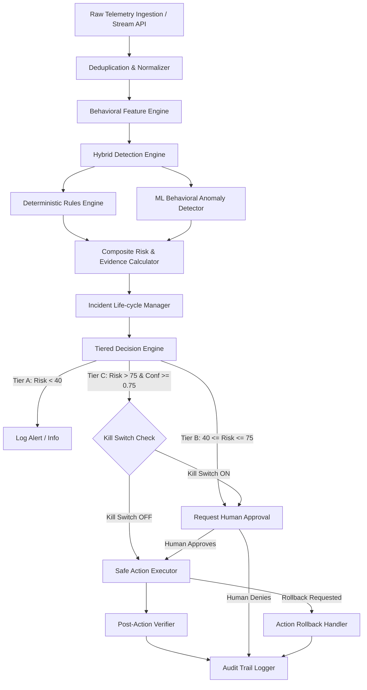

# System Architecture (ARCHITECTURE.md)

## System: Suraksha AI (Phase 2 Pipeline)

---

## Component Specifications

### 1. Ingestion, Deduplication & Normalizer (`backend/detection/normalizer.py`)
- Standardizes syslog, JSON files, and network stream arrays into `NormalizedEvent`.
- **Deduplication Engine**: Hash-based sliding window filtering out identical event hashes within a 60-second window.
- **Out-of-Order Sorting**: Sorts sequential event streams by ISO timestamp before ingestion.

### 2. Behavioral Feature Engine (`backend/detection/behavioral_engine.py`)
Maintains rolling state windows per `user_id` and `source_ip`:
- `failed_login_count`: Rolling 5-minute counter.
- `login_frequency`: Logins per minute.
- `off_hours_flag`: Boolean (1.0 if access between 18:00 - 08:00 UTC).
- `unique_destinations`: Count of unique internal targets accessed.
- `privilege_change_events`: Count of sudo/admin attempts.
- `data_transfer_volume_mb`: Cumulative outbound transfer volume.
- `connection_frequency`: Rate of network/C2 requests.

### 3. Detection Engine (`backend/detection/`)
- **`rules_engine.py`**: Evaluates 6 categories (`SUSPICIOUS_LOGIN`, `BRUTE_FORCE`, `PRIVILEGE_ESCALATION`, `LATERAL_MOVEMENT`, `C2_ACTIVITY`, `UNUSUAL_DATA_TRANSFER`).
- **`ml_detector.py`**: Uses an IsolationForest model trained on 6D behavioral vectors `[failed_logins, data_mb, unique_dests, conn_freq, off_hours, priv_changes]` to output an Anomaly Score $\in [0.0, 1.0]$ alongside behavioral evidence tags.

### 4. Risk & Decision Engine (`backend/detection/risk_calculator.py`, `backend/response/decision_engine.py`)
$$ \text{Risk Score} = \min\left(100, (\text{RuleSeverity} \times 0.55 + \text{MLAnomalyScore} \times 45) \times \text{AssetCriticality} \right) $$
$$ \text{Confidence Score} = \frac{\text{RuleConfidence} \times 0.6 + \text{MLScore} \times 0.4}{1.0} $$

### Decision Tiering Matrix
- **Tier A (Info/Low)**: Risk $< 40$. Log alert only.
- **Tier B (Medium)**: $40 \le \text{Risk} \le 75$ OR high ML score without rule match. Requires Human Approval.
- **Tier C (High/Critical)**: Risk $> 75$ AND Confidence $\ge 0.75$. Auto-executes safe simulated response UNLESS Kill Switch is Active.

### 5. Safe Executor, Verifier & Rollback (`backend/response/executor.py`, `verifier.py`)
- `BLOCK_IP`: Simulates dynamic IP block. Verification checks active simulated firewall table. Reversible via `UNBLOCK_IP`.
- `SUSPEND_SESSION`: Invalidates target token state. Reversible via `REACTIVATE_SESSION`.
- `ISOLATE_ENDPOINT`: Sets endpoint network flag to Isolated. Reversible via `REJOIN_NETWORK`.

### 6. Audit & RBAC (`backend/audit/logger.py`, `backend/rbac.py`)
- Tamper-evident append-only JSON structure.
- Roles: `ADMIN`, `ANALYST`, `AUDITOR`.
